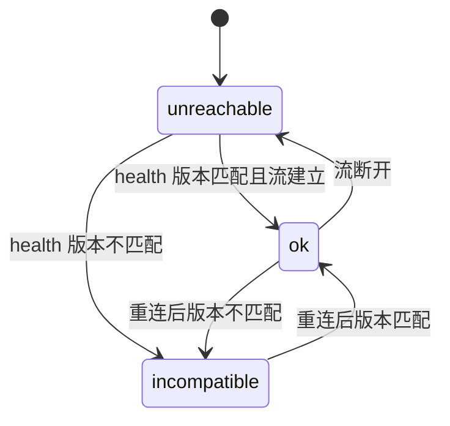

## Problem Statement

我在多台自有机器上各运行一个 `agent`。每台机器的 SQLite 持有自己的 workspace、session、消息树、队列与事件，权威状态按机器分开。

现在我要为每台机器单独开一个浏览器页面。我无法在一个页面里对照多台机器的 session，无法用同一个入口切换，也无法让第二个浏览器（另一台设备）看同一批会话。原 `ui` 只代理一个写死的 `agent` 地址，因此这条路走不通。

## Solution

把原 `ui` 升级为 `hub`。`hub` 是唯一浏览器入口，也是总线：

- `hub` 有自己的 SQLite，只存节点表。我在页面里注册、改名与删除 `node`。
- `hub` 为每个 `node` 维持常驻上游事件流，把 N 个 `agent` 的协议合并成单一 `/api/*` 与单一合并事件流。
- 客户端状态按 `node` 分片，侧栏顶部用节点切换器选择当前节点，URL 直达 session。
- 权威状态仍在各 `node` 的 SQLite。`hub` 不缓存领域状态。
- 跨机器访问由我自建的 SSH 隧道或 VPN 提供。双方仍只绑定 loopback，协议无鉴权。
- 同时移除并发槽位：session 内的 run 严格串行，session 之间没有上限。

## User Stories

### 节点管理

- **H-1** 作为用户，我想在页面里注册一个 `node`，只填名称与 URL，以便不重启 `hub` 就能接入新机器。
- **H-2** 作为用户，我想在隧道还没开、`agent` 还没起时就注册 `node`，以便配置与运行解耦。
- **H-3** 作为用户，我想在名称重复时收到显式错误，以便节点身份不会含糊。
- **H-4** 作为用户，我想在名称为空或 URL 非法时收到显式错误，以便节点表始终可用。
- **H-5** 作为用户，我想改节点名，以便名字贴合当前的机器用途。
- **H-6** 作为用户，我理解改名会使旧 URL 失效，以便我不误以为旧链接还能用。
- **H-7** 作为用户，我想在打开指向未知节点的链接时看到「未知节点」状态，以便分清「配置丢了」与「服务挂了」。
- **H-8** 作为用户，我想删除一个 `node`，以便我退掉一台机器后节点表保持干净。
- **H-9** 作为用户，我想让删除只移除登记，以便那台机器上的 `agent`、SQLite 与在跑的 run 都不受影响。
- **H-10** 作为用户，我想在重启 `hub` 后仍然看到节点表，以便节点配置不用重填。

### 节点状态

- **H-11** 作为用户，我想在侧栏看到每个节点的状态 `ok`、`unreachable`、`incompatible`，以便一眼分出「能用」「连不上」「版本不对」。
- **H-12** 作为用户，我想看到节点失败的具体说明，以便我知道是隧道断了还是 `agent` 版本旧。
- **H-13** 作为用户，我想在节点不是 `ok` 时看到它的 session 列表为空，以便我不把空列表当成「没有会话」。
- **H-14** 作为用户，我想在节点不是 `ok` 时命令按钮禁用，以便我不会发出注定失败的写操作。
- **H-15** 作为用户，我想在 `agent` 的协议版本与 `hub` 不符时看到 `incompatible`，以便我升级落后的一侧。
- **H-16** 作为用户，我想让 `hub` 自动重连掉线的节点，以便我恢复隧道后不用刷新页面。
- **H-17** 作为用户，我想让重连使用退避，以便 `agent` 长时间不在时不会刷爆日志与端口。

### 节点运维

- **H-53** 作为用户，我想直接改节点 URL，以便机器换端口时不用删除再注册。
- **H-54** 作为用户，我想停用一个节点，以便关机的机器不再被重连。
- **H-55** 作为用户，我想在启用后立刻尝试连接，以便恢复隧道后不用等退避。
- **H-56** 作为用户，我想手动触发一次重连，以便我确定隧道已经通了。
- **H-57** 作为用户，我想看到每个节点最后一次事实事件的时间，以便区分「安静」与「卡住」。
- **H-58** 作为用户，我想看到节点 health 的往返延迟，以便判断链路质量。
- **H-59** 作为运维者，我想用启动参数设回放窗口容量，以便按机器数量与事件量调整。
- **H-60** 作为开发者，我想让停用节点的上游流立即结束，以便资源立刻回收。

### 视图与导航

- **H-18** 作为用户，我想在侧栏顶部用节点切换器选择节点，以便一次专注一台机器的 workspace 与 session。
- **H-19** 作为用户，我想让 URL 形如 `#/n/<node>/s/<session_id>`，以便我能直接分享或收藏某个 session 的地址。
- **H-20** 作为用户，我想在刷新页面后恢复同一节点与同一 session，以便我不丢上下文。
- **H-21** 作为用户，我想让缩放与窄视口下的布局仍然可用，以便在笔记本与平板上都能操作。
- **H-22** 作为用户，我想让不可达节点的分组仍然留在侧栏里，以便我看得出「我配过这台机器」。

### 合并协议

- **H-23** 作为用户，我想用一次 `GET /api/bootstrap` 取得节点表、每节点状态与可达节点的元数据，以便首屏只需一次往返。
- **H-24** 作为用户，我想让一个节点失败不影响整个 bootstrap，以便一台机器关机不会让页面白屏。
- **H-25** 作为用户，我想让节点作用域的命令走 `/api/n/<node>/...`，以便请求去哪个节点在 URL 上就写明。
- **H-26** 作为用户，我想让 `hub` 把节点作用域请求原样转发，以便 `agent` 的领域协议一字不改。
- **H-27** 作为用户，我想让未知节点名返回显式错误码，以便我区分拼错名字与节点离线。
- **H-28** 作为用户，我想让非 `ok` 节点的命令返回显式错误码，以便错误原因在 UI 里能读。

### 事件流与续传

- **H-29** 作为用户，我想只面对一条合并事件流，以便客户端不必维持 N 条流与 N 个游标。
- **H-30** 作为用户，我想让每条事实信封带 `hub` 广播序号与节点名，以便我知道事件来自哪台机器、位置在哪。
- **H-31** 作为用户，我想用广播序号续传，以便断线重连不丢事件也不重复应用。
- **H-32** 作为用户，我想让游标落在回放窗口内时直接回放，以便短暂断线不需要重取整棵树。
- **H-33** 作为用户，我想让游标落在窗口外时收到 resync 指示，以便客户端显式重建视图而不是静默错乱。
- **H-34** 作为用户，我想让 `hub` 重启后窗口为空并要求 resync，以便我不依赖 `hub` 的持久广播状态。
- **H-35** 作为用户，我想让 `hub` 在某个客户端跟不上广播时只断开那个客户端，以便一个挂起的标签页不会拖垮整个总线。
- **H-36** 作为用户，我想在断开后自动重连并 resync，以便恢复时不需手动刷新。
- **H-37** 作为用户，我想让 token 增量不推进游标，以便续传语义只由事实事件定义。

### 多客户端

- **H-38** 作为用户，我想从多个浏览器与多台设备同时打开 `hub`，以便在不同屏幕上协作同一批会话。
- **H-39** 作为用户，我想让任一客户端的命令对全部客户端可见，以便我提交后另一屏立刻看到。
- **H-40** 作为用户，我想让两个客户端同时写不同 session 时都成功，以便我不被无谓的锁拒绝。
- **H-41** 作为用户，我想让冲突写入返回 `agent` 已有的冲突错误，以便错误语义仍然单点定义。
- **H-42** 作为用户，我想在自己任何一个客户端注册或删除节点后，让其它已打开的客户端立刻看到，以便侧栏不会分叉。
- **H-43** 作为用户，我想让节点状态迁移实时到达所有客户端，以便我不靠刷新判断哪台机器掉线。

### 无并发上限

- **H-44** 作为用户，我想让每条队列项被取出即启动 run，以便我不必等一个全局槽位。
- **H-45** 作为用户，我想让同一 session 的 run 仍然串行，以便会话内顺序不被并发打乱。
- **H-46** 作为用户，我想在超出供应商限流时看到显式的 run 失败类别，以便我知道是上游限流而不是丢消息。
- **H-47** 作为用户，我想让并发的上限由机器与供应商自然施加，以便 `hub` 不引入含糊的全局配额。

### 工程

- **H-48** 作为开发者，我想让 `hub` 与 `agent` 共用一套生成的协议类型，以便形状漂移在编译期暴露。
- **H-49** 作为开发者，我想让 `hub` 的合并、广播与节点状态由公开 HTTP 边界的测试覆盖，以便回归能被拦住。
- **H-50** 作为开发者，我想让 client 的 reducer 测试按节点分片调用，以便多节点串扰能被拦住。
- **H-51** 作为开发者，我想在 `devenv shell` 里完成构建、测试、类型生成与 Storybook，以便环境唯一。
- **H-52** 作为开发者，我想让节点切换器、节点状态标记、未知节点都有 stories，以便视觉门禁覆盖新状态。

## Implementation Decisions

### 进程与部署

- `hub` 由现 `ui` 二进制重命名而来。它内嵌客户端资源、托管 web UI、持有自己的 SQLite。
- `hub` 与 `node` 都只绑定 `127.0.0.1`。跨机器访问由用户自建 SSH 隧道或 VPN 提供；协议无鉴权、无 TLS 终止。
- `hub` 启动参数：监听地址、可选的 `hub` 数据库路径与可选的日志目录，以及回放窗口条数与广播通道容量。省略时用平台标准目录与默认容量（ADR 0026）。删除 `--agent-url`，不引入 `--node` 参数。
- `node` 侧只有一处协议增补：`/api/health` 返回 `protocol_version`。

### 持久化

- `hub` 的 SQLite 只有 `node` 表：`name` 为主键，另有 `url`、`enabled`、`created_at` 与 `updated_at`。
- 迁移随二进制内嵌，单写入线与存储管线复用内核。旧库升级后 `enabled` 为 true，`updated_at` 取原 `created_at`。
- `hub` 不存 session、workspace、消息、队列、run 或事件。
- 节点名即身份。注册时校验非空、唯一、URL 非空；不校验可达性。

### HTTP 契约

聚合端点由 `hub` 自身提供：

- `GET /api/bootstrap`：节点表、每节点 `status` 与 `detail`、可达节点的 bootstrap。
- `GET /api/events?after=<hub_seq>`：单一合并事件流。
- `POST /api/nodes`、`PATCH /api/nodes/{name}`、`DELETE /api/nodes/{name}`：节点表管理。`PATCH` 的请求体为可选字段 `name`、`url`、`enabled`，省略即保留原值。
- `POST /api/nodes/{name}/reconnect`：丢弃当前上游订阅并按退避起点立即重建。停用的节点返回 `node_unavailable`。
- `GET /api/health`：`hub` 自身健康与 `protocol_version`。

节点作用域：`/api/n/<node>/<rest>` 转发到该节点 `url` 下的 `/api/<rest>`。方法、查询、请求体与 SSE 全部原样透传，不缓冲、不聚合、不改写。

信封：`hub` 在每条上游事实信封外再包一层，加入 `hub_seq` 与 `node`，保留原信封字段。token 增量与限流重试提示不带 `hub_seq`，不推进游标，也不进回放窗口。

`hub` 自身的事实事件走同一条流：`node_registered`、`node_removed`、`node_updated`、`node_status_changed`。它们带 `hub_seq`，不带 `node` 字段。节点表变更因此对所有已打开的客户端立即可见，不需要刷新。

节点视图：`NodeSnapshot` 带 `status`、`detail`、`enabled`、`last_event_at` 与 `latency_ms`。`last_event_at` 是该节点最后一条事实事件自带的时间戳；`latency_ms` 是最近一次 health 的往返毫秒数。两者是进程内计数，不落库。改 URL 与启用标志广播 `node_updated`；改名仍按「删除加登记」广播。

停用的节点不建上游订阅，视图为 `unreachable` 且说明「节点已停用」，节点作用域命令返回 `node_unavailable`。启用与改 URL 后视图先写「正在建立上游连接」，由 watcher 的探测结果覆盖（ADR 0041）。

类型命名：`hub` 自有的协议类型加 `Hub` 前缀（`HubBootstrap`、`HubHealth`、`HubErrorCode`、`HubErrorResponse`），避免与 agent 导出的同名类型在生成目录里互相覆盖。节点领域类型（`NodeName`、`NodeSnapshot`）由 `hub` 导出。

新增错误码：`unknown_node`、`node_name_taken`、`node_name_invalid`、`node_unavailable`。

### 总线

- `hub` 为每个 `ok` 节点维持一条常驻上游流，指数退避重连。
- 上游 `resync` 只触发重连，不改节点状态，也不重置上游游标（ADR 0030）。
- 节点注册后立即尝试连接；删除后关闭流。
- 停用后立即关闭该节点的上游流，启用与手动重连立即重建，不等待退避。
- `hub` 保一个按 `hub_seq` 索引的内存有界回放窗口，容量可配置。
- 每个客户端一个有界发送队列，溢出即关闭该客户端的事件流。
- 事实事件不回填到窗口之外。窗口外游标一律 resync。

### 节点状态机

### 客户端

- 状态形状：`{ hub: { nodes, selected, cursor }, nodes: Record<node, NodeState> }`。
- 每个 `NodeState` 由既有 reducer 推导，输入是该节点的事实事件与 token 增量。分片之间互不影响。
- 事件流全量到达。未选中节点的分片照样更新，切换节点零网络请求。
- 侧栏顶部是节点切换器，显示节点名与状态标记。
- 不可达节点的列表为空并显示错误说明，命令按钮禁用。
- transcript 只来自选中节点的分片。

### 移除并发槽位

- 删除并发槽位概念、`DURABLE_MAX_CONCURRENCY` 配置、信号量与等待槽位的路径。
- 队列项被取出即启动 run。session 内的 FIFO 仍串行化自身 run。
- 删除断言全局并发槽位的 scheduler 测试。

## Testing Decisions

好的测试只断言外部可观察的行为：HTTP 状态与错误码、事件流内容与顺序、SSE 续传结果、SQLite 重启后的恢复、文件系统副作用。测试不替换被测代码，不断言内部结构与私有函数。

沿用仓库既有约定：三个 seam 全部位于公开边界，脚本化 provider 是运行在本地的真实 HTTP 服务，不是打桩对象。

### Seam 1：`agent` 的 HTTP API

沿用既有 harness：真实 `agent`、临时 workspace、临时 SQLite、随机本地端口、脚本化 provider。本次改动新增的断言：

- `/api/health` 返回 `protocol_version`。
- 同一 session 连续提交三条消息严格 FIFO；不同 session 同时提交时都立即启动，没有等待。
- 删除并发槽位后，重启恢复、取消语义与分支命令的既有断言全部保持通过。
- 配置读取不再接受 `DURABLE_MAX_CONCURRENCY`。

### Seam 2：client 纯 reducer

沿用 Vitest 直接调用 reducer。本次改为按节点分片调用：

- 同一事件重复到达只影响对应分片。
- 两节点事件交错到达时，各自分片互不影响。
- 切换选中节点不改变任何分片内容。
- 广播序号窗口外指示触发 resync 后，分片按新的 bootstrap 重建。

### Seam 3：`hub` 的 HTTP API

新增 seam。形态：真实 `hub`（临时数据库、随机端口）、两个真实 `agent`（各自临时 workspace 与 SQLite、各指向脚本化 provider）、一个不监听端口的 URL 充当不可达节点。测试经 `hub` 的 HTTP 与 SSE 驱动，复用 Seam 1 的 harness 辅助以启动真实 `agent`。

覆盖模块：节点表与迁移、节点作用域转发、合并 bootstrap、广播序号、回放窗口、上游重连与节点状态机、客户端隔离、协议版本握手。`hub` crate 内的单元测试补充 HTTP 层难以确定性复现的部分：落后订阅者的 `resync` 映射与窗口回放顺序。

验收标准：

- 两个可达节点加一个不可达 URL 的 bootstrap 返回 200，状态分别为 `ok`、`ok`、`unreachable`。
- `POST /api/n/a/sessions` 只落在节点 a；节点 b 的 session 列表不变。
- 未知节点名返回 `unknown_node`；非 `ok` 节点的命令返回 `node_unavailable`。
- 重复注册同一节点名返回 `node_name_taken`；空名返回 `node_name_invalid`。
- 改名保留 URL 与注册时间，旧名立即返回 `unknown_node`，新名可达；改名对已打开的客户端表现为 `node_removed` 加 `node_registered`。
- 合并事件流的 `hub_seq` 严格递增且不重复。
- 游标落在窗口内时回放缺失事件，且不重复已见事件。
- 游标落在窗口外时返回 resync 指示。
- 落后的订阅者收到 `resync` 且其流结束；同一 hub 的其它订阅者不受影响。该条由 `hub` 内 SSE 处理器的单元测试覆盖：落后在 socket 缓冲层面无法稳定复现，测试直接驱动订阅到事件序列的映射。
- 协议版本不匹配的 `agent` 使节点状态变为 `incompatible`。
- `hub` 重启后窗口为空，带旧游标的订阅要求 resync。
- 删除节点后其上游流关闭，且再次请求该节点返回 `unknown_node`。
- 改 URL 后命令转发到新地址，节点记录与 `created_at` 不变，客户端收到 `node_updated`。
- 停用后节点表仍在、状态为 `unreachable` 且说明「节点已停用」，命令返回 `node_unavailable`，且不再有上游连接尝试。
- 启用后无需等待退避即建立上游连接；手动重连在隧道恢复后 1 秒内把状态改回 `ok`。
- 发出一条事实后 `last_event_at` 前进；节点无事件时该值不变。`latency_ms` 在 health 成功后非空。
- 回放窗口容量为 1 时，窗口内游标收到回放，窗口外游标收到 resync。
- 迁移在既有库上升级后节点表内容不变，`enabled` 为 true。

### 渲染与视觉

节点切换器、节点状态标记、不可达节点、未知节点纳入既有 Storybook 覆盖清单，并接受视觉门禁。

## Out of Scope

- 多人、用户身份、鉴权、TLS 终止、公网监听。
- `hub` 之间共享、同步或级联。只有一个 `hub`。
- 跨节点领域操作：会话迁移、跨节点搜索、把一个 workspace 注册到多台机器。
- `hub` 缓存 `node` 的领域状态。
- `hub` 自动建立 SSH 隧道或 VPN。
- 节点改名后的旧链接重定向。
- 配置文件（TOML/YAML）。
- 继承主规格的其余非目标：容器或沙箱隔离、工具审批、上下文压缩、MCP、子代理、计划模式、成本统计等。

## Further Notes

- 决策记录：ADR 0021（`hub` 作为总线）、ADR 0022（节点名即身份）、ADR 0023（移除并发槽位）、ADR 0024（客户端分片状态与广播游标）。ADR 0003 与 0014 已标注并发槽位部分被 0023 取代；ADR 0018 已标注客户端游标部分被 0024 取代。
- 本文与 `docs/specs/multi-node-hub.md` 同源，并已发布为 issue #11。
- 主规格 `docs/specs/rust-react-coding-agent.md` 已完成定点修订：删除被推翻的非目标、`ui` 改为 `hub`、删除并发槽位、指向本规格。
- 器件与环境命名待同步：二进制重命名后，`AGENTS.md` 的目录表与命令表、`devenv.nix` 的命令入口都要从 `ui` 改为 `hub`。
- 建议的纵向切片顺序（每片独立通过 `durable-test`）：① `agent` 的 `protocol_version` 与移除并发槽位；② `hub` 的节点表与迁移；③ `hub` 的合并 bootstrap 与节点作用域转发；④ `hub` 的总线与回放窗口；⑤ client 的节点切换器与分片状态；⑥ client 的节点注册、改名与删除。
- 切片 ⑤ 只做节点切换器与分片状态；页面内的节点注册、改名与删除在切片 ⑥。
