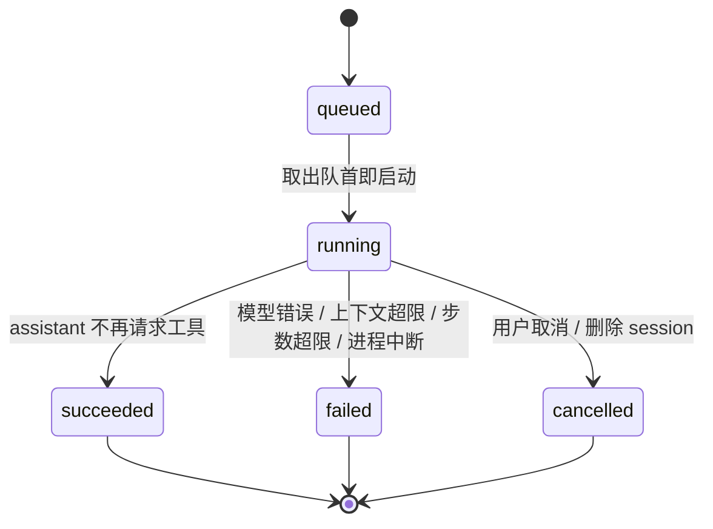

> 主 issue: #1
>
> 多节点 hub 的增补与修订见 `docs/specs/multi-node-hub.md`。

# 规格：Rust + React 的最小 C/S 架构 coding agent

## 问题陈述

用户在本机管理多个代码目录，希望在一个浏览器界面里同时与多个 coding agent 会话协作。agent 能读文件、写文件、精确编辑文件并执行 shell 命令。用户需要看到流式输出、控制执行顺序、取消执行，并在不满意时改写历史消息或重试，同时保留旧历史以便切换比较。

现有工具通常把 agent 与界面耦合在一个进程里，或要求远程服务与鉴权。本规格把 agent 与 web UI 拆成两个独立二进制：agent 独占模型调用、工具执行与会话状态；UI 只托管静态资源并转发 API。浏览器不持有权威状态，刷新、断线、重启后仍能恢复一致视图。

## 目标

- 本机单用户运行；`agent` 与 `hub` 两个二进制可独立启动与重启。
- 多 workspace 注册；多 session 并发；session 内持久 FIFO 队列。
- 工具：`read_file`、`write_file`、`edit_file`、`bash`。工具自动执行，路径限定在 session 所属 workspace 根内。
- 流式输出经单一 SSE 流送达所有标签页；断线按游标续传。
- 消息树与分支：编辑用户消息、重试 assistant 响应都产生兄弟分支，可切换。
- SQLite 持久化 workspace、session、消息树、队列、事件；重启后恢复。
- Rust 与 TypeScript 共用一套生成式协议类型。
- 前端组件与页面由 Storybook stories 覆盖，Chromatic 提供视觉门禁。

## 非目标

- 多用户与用户身份、鉴权、TLS 终止。跨机器访问由多节点 hub 承载，见 `docs/specs/multi-node-hub.md`。
- 容器或沙箱隔离、命令白名单、网络限制、工具审批。
- `list_dir` 工具；目录探查由 `bash` 完成。
- diff 渲染、语法高亮、图片或文件附件、语音输入。
- MCP、子代理、计划模式、自定义 system prompt、per-session 模型选择。
- 上下文压缩或自动摘要。
- 单分支删除、分支重命名、分支合并。
- git 状态面板、提交操作、worktree 管理。
- 成本与 token 统计、事件压缩与保留策略。
- 配置文件（TOML/YAML）；远程日志与指标导出。
- 移动端专属交互（手势、底部导航）。

## 用户故事

### workspace 与 session

1. 作为用户，我可以把一个绝对目录注册为 workspace。注册时 server 校验路径存在且为目录，并以规范化绝对路径作为身份。重复注册返回显式错误。
2. 作为用户，我可以移除 workspace。若该 workspace 仍有 session，server 显式拒绝并说明原因。
3. 作为用户，我可以在指定 workspace 下创建 session。session 创建后立即可用，标题为默认值。
4. 作为用户，我在 session 中提交第一条用户消息后，标题自动取该消息首行前 50 字符；我可以随时重命名，重命名后不再自动更新。
5. 作为用户，我可以删除 session。删除运行中的 session 时，server 先取消当前 run、杀掉在途工具进程、丢弃队列，再删除消息树与事件。UI 在执行删除前要求二次确认。
6. 作为用户，我可以在侧栏看到所有 workspace 与 session，以及每个 session 是否有活动 run、队列长度与更新时间；session 按最近更新时间排序。

### 对话与工具执行

7. 作为用户，我提交消息后立即收到入队确认；该消息进入 session 的 FIFO 队列。
8. 作为用户，我看到 assistant 文本以流式增量显示；run 结束时文本完整落库，刷新后内容一致。
9. 作为用户，我看到每个工具调用以可折叠卡片展示：工具名、入参、结果或错误。
10. 作为用户，我可以在 run 进行中点击取消。server 中止在途模型请求、杀掉 bash 进程组，已收到的部分 assistant 文本作为「已取消」消息保留，状态为 cancelled，队列继续执行下一项。
11. 作为用户，我可以删除尚未开始的队列项；已开始的 run 只能取消，不能删除。
12. 作为用户，当工具执行失败（文件不存在、编辑不唯一、非零退出、超时）时，错误作为工具结果回传模型，run 继续。
13. 作为用户，当模型请求失败、超出上下文上限或超出步数上限时，run 以明确错误结束，队列继续；UI 显示错误类别与说明。
14. 作为用户，我可以同时运行多个 session 的 run，没有并发上限。session 内仍按 FIFO 串行。
15. 作为用户，我在同一个 session 的上一个 run 未结束时提交新消息，消息进入队列，不打断当前 run。

### 分支历史

16. 作为用户，我可以编辑任意一条历史用户消息。server 在该消息的父节点下创建新的兄弟用户消息，把 active leaf 移到新消息，并把新消息入队执行；旧消息及其子树完整保留。
17. 作为用户，我可以重试任意一条 assistant 消息。server 以其父用户消息为起点创建新 run，新 assistant 消息与旧消息同父，active leaf 移到新消息；不重复创建用户消息。
18. 作为用户，当某条消息存在兄弟时，我看到 `‹ 2/3 ›` 切换器。切换把 active leaf 移到目标子树中最近产生的叶子，transcript 随之改变。
19. 作为用户，编辑、重试、切换分支都只在 session 空闲且队列为空时可用；不满足时 server 返回显式冲突错误，UI 置灰相应操作。
20. 作为用户，我理解编辑、重试、切换分支都不可撤销；UI 对编辑与重试要求二次确认。

### 恢复与多客户端

21. 作为用户，我刷新页面后通过 bootstrap 元数据与当前 session 的消息树恢复完整视图，正在进行的 run 显示已收到的部分输出。
22. 作为用户，SSE 断线后客户端用最后事件 id 续传，不丢失也不重复应用事件。
23. 作为用户，我可以在多个标签页同时打开 UI；所有标签页收到同一事件流，任一标签页的命令对全部标签页生效。
24. 作为用户，server 重启后我看到全部 workspace、session、消息树与队列；重启前处于 running 的 run 显示为 failed，原因为进程中断。
25. 作为用户，我在 UI 中看到 SSE 连接状态；断线时显示重连中，恢复后自动回到实时状态。

### 工具契约

26. 作为用户，`read_file` 读取 UTF-8 文本，可指定行区间，输出带行号。非 UTF-8、超出字节上限、区间非法时返回显式错误。
27. 作为用户，`write_file` 覆盖写入文件；父目录不存在时返回显式错误，不隐式创建目录。
28. 作为用户，`edit_file` 用 `new_string` 替换唯一匹配的 `old_string`；未找到与多处匹配是两种不同错误；不支持正则与全部替换。
29. 作为用户，`bash` 以 `sh -c` 执行，cwd 限定 workspace 根内，stdin 关闭，返回合并输出、退出码与耗时；超过输出上限时标注截断；默认 120 秒超时，超时或取消时杀掉整个进程组。
30. 作为用户，我对所有工具路径的逃逸尝试（绝对路径、`..`、符号链接）都被拒绝，并收到显式错误。

### 前端与工程

31. 作为开发者，我在单页界面中完成全部操作：侧栏管理 workspace/session，右侧查看 transcript、队列、取消、连接状态与错误横幅；session 记录在 URL hash 中。
32. 作为开发者，assistant 消息渲染 markdown 与代码块，不做语法高亮与 diff；工具卡片可折叠；不使用 `any`。
33. 作为开发者，每个纯展示组件与页面组合都有 Storybook stories，使用静态 fixture 覆盖空会话、流式中、工具调用、错误、多 session 并发、分支切换、长文本溢出。
34. 作为开发者，我在本地运行 Storybook 查看全部状态；CI 发布 Chromatic 并阻止含未接受视觉变更的合并。
35. 作为开发者，Rust 协议类型变更后重新生成 TS 类型；生成文件已提交，CI 校验重新生成后无差异。
36. 作为开发者，我在 `devenv shell` 中执行构建、测试、类型生成与 Storybook 命令。

## 实现决策

### 进程与部署

- 两个 Rust 二进制：`agent` 与 `hub`（原 `ui`）。两者默认只监听 `127.0.0.1`。
- `agent` 只提供 HTTP API，不托管前端资源。启动参数包含监听地址、SQLite 路径、可重复的初始 workspace 路径。模型配置经环境变量提供。
- `hub` 内嵌构建后的 React 静态资源并托管，持有节点表，把全部 node 的协议合并成单一 `/api/*` 与单一事件流。启动参数包含监听地址与 `hub` 数据库路径。细节见 `docs/specs/multi-node-hub.md`。
- 浏览器始终同源访问 `hub`，不需要 CORS。鉴权、TLS、公网监听不在本规格内。
- `agent` 缺少必需配置时启动失败，错误信息指出缺失项。

### 协议

- 命令使用 HTTP + JSON；事件使用单一全局 SSE 流。
- 事件信封包含：全局自增 id、`session_id`、类型、负载、时间戳。全局 id 单调递增，用作续传游标。
- 事实事件持久化：session 创建/重命名/标题更新/删除、workspace 注册/移除、用户消息、assistant 完整消息、工具调用、工具结果、run 状态转换、active leaf 变更、队列项入队/移除。token 增量只经 SSE 传输，不持久化。
- SSE 每 15 秒发送注释行保活。多个标签页可同时订阅同一条事件流。
- `agent` 提供以下命令面：
  - 读取 bootstrap 元数据：workspace 列表、session 元数据、模型名、当前最大事件 id。
  - 读取单个 session 的消息树：全部节点、active leaf、队列、当前 run 状态与已收到的部分输出。
  - 订阅事件流，支持 `after` 游标。
  - 注册与移除 workspace。
  - 创建、重命名、删除 session。
  - 提交用户消息（入队）、取消当前 run、删除队列项。
  - 编辑历史用户消息、重试 assistant 消息、切换 active leaf。
- 错误响应包含稳定的错误码、人类可读说明与 HTTP 状态。错误码至少区分：workspace 路径无效、workspace 重复、workspace 非空、session 不存在、run 进行中冲突、队列非空冲突、路径逃逸、文件不存在、非 UTF-8、编辑未匹配、编辑多处匹配、读取超限、bash 超时、模型上游错误、上下文超限、步数超限、配置缺失。bash 输出截断不是错误，在工具结果中标注。
- 协议类型由 Rust 定义，用 `ts-rs` 生成 TS 类型；生成文件写入前端固定目录并提交到仓库，CI 重新生成并比较。
- 消息节点包含：id、parent_id、role（user/assistant）、文本、工具调用与结果、run 关联、创建时间。assistant 的取消状态与失败原因作为节点元数据保存。

### 调度与会话状态

- 每个 session 有 FIFO 队列。入队即持久化；run 结束（成功、失败、取消）后自动取下一项。
- 队列项在开始执行时成为当前 active leaf 的子消息节点。
- 全局并发槽位不存在。session 内 run 严格串行，session 之间没有上限。
- 每个 run 有状态：queued、running、succeeded、failed、cancelled。session 存在 running 的 run 时视为忙碌。

- 编辑、重试、切换分支要求 session 空闲且队列为空，否则拒绝。
- assistant 消息的兄弟节点由「父节点 + 新建 run」产生；用户消息的兄弟节点由编辑产生。
- 分支切换只修改 active leaf，并把变更作为事实事件广播与持久化。
- 会话 transcript 等于 root 到 active leaf 的路径，也是每轮发给模型的上下文。
- server 启动时把仍为 running 的 run 标记为 failed，原因为进程中断，并继续执行其队列。

### 模型调用

- 内部窄 trait 只有一项职责：发起一轮带工具定义的流式请求，返回文本增量与工具调用。v1 只实现 OpenAI 兼容 `/v1/chat/completions`。
- 每轮请求包含内置 system prompt、当前 transcript、全部工具定义，`stream` 为真。
- 同一 assistant 消息返回多个工具调用时，按顺序依次执行，收集全部结果后再请求下一轮。
- assistant 不再请求工具时 run 成功结束。
- 最大步数默认 50，可配置；超限以显式错误结束 run。
- 上下文按字符数限制，默认 200000，可配置；超限以显式错误结束 run，不截断、不摘要。
- 模型上游错误（网络、非 2xx、流解析失败）终止当前 run，队列继续。
- system prompt 内置：说明工具使用方式、workspace 边界、禁止猜测文件内容、回答保持简洁。v1 不提供自定义入口。

### 工具

- 执行器在调用前把路径解析到 workspace 根内：拒绝绝对路径、`..` 逃逸、规范化后位于根外的符号链接目标。
- `read_file`：UTF-8；可选起止行；输出带行号；默认字节上限 256 KiB，超限报错。
- `write_file`：覆盖写入；父目录必须存在；返回写入字节数。
- `edit_file`：`old_string` 必须唯一匹配；未找到与多处匹配为不同错误；不做正则与全部替换。
- `bash`：`sh -c`；cwd 默认 workspace 根，可选根内子目录；stdin 关闭；stdout 与 stderr 合并；返回退出码与耗时；输出上限默认 64 KiB，超出时在结果中标注截断；默认超时 120 秒；超时或取消杀掉进程组。
- 工具错误作为结构化工具结果回传模型，run 继续。工具不设置审批步骤。

### 持久化

- SQLite 存储 workspace、session、消息节点、事实事件、队列项、run 状态。
- 迁移随二进制内嵌，启动时自动应用。
- 事件 id 由数据库自增序列产生；bootstrap 返回当前最大值；`after` 回放按 id 升序。
- 删除 session 删除其消息树、事件与队列；不触碰 workspace 文件系统。
- 移除 workspace 只删除注册记录，不触碰磁盘。
- v1 不做事件保留与压缩。

### 前端

- 页面采用响应式布局，整体占据一个 viewport：`body` 不产生页面级滚动，侧栏列表与 transcript 各自内部滚动，队列与输入区始终可见。
- 侧栏宽度用 `clamp` 随视口收缩；窄视口隐藏标题与状态等次要文字，仅保留主信息。
- 短视口下输入区与队列降低内边距并限制高度，队列超出时内部滚动。
- 单页应用，无路由；选中的 session id 写入 URL hash，刷新后恢复。
- 左侧栏：workspace 列表、session 列表、创建与重命名与删除、注册 workspace；显示当前模型名。
- 右侧：当前 session 的 transcript、队列列表、输入框、取消按钮、SSE 连接状态、错误横幅。
- transcript 由客户端根据消息树与 active leaf 计算；分支切换器显示在存在兄弟的节点上。
- assistant 文本渲染 markdown 与代码块，不引入语法高亮；工具卡片可折叠。
- 客户端状态由纯 reducer 从事件流与消息树推导；组件不持有业务状态，不拼接对话历史。
- 断线后重新获取 bootstrap 元数据与当前 session 树，并用最后事件 id 续传。
- 多标签页之间不做互斥；server 返回的冲突错误直接显示。
- TypeScript 严格模式，禁止 `any`；页面不含注释性说明。

### 工程编排

- `devenv.nix` 提供 Rust（stable + clippy + rustfmt）与 Node + npm，并提供构建 agent、构建 client、运行测试、生成类型、启动 Storybook 的命令入口。
- Cargo workspace 包含 `agent` 与 `hub` 两个 crate；协议类型与 `ts-rs` 导出位于 agent。
- 前端使用 npm + Vite + React + TypeScript + Storybook + Chromatic + Vitest。
- Storybook：每个纯展示组件与页面组合提供 stories，数据来自静态 fixture。
- 生成物：前端固定目录下的 TS 协议类型；`hub` 内嵌的 client 构建产物。

## 测试决策

测试 seam 共四个：本文档定义 Seam 1、Seam 2 与 Seam 4，多节点规格定义 Seam 3。所有 seam 都位于公开边界；不使用 mock 替换被测代码。脚本化 provider 是运行在本地的真实 HTTP 服务，模拟外部模型供应商。`hub` 的合并协议与总线由多节点规格新增的 Seam 3 覆盖。

### Seam 1：`agent` 的 HTTP API

**形态**：测试启动真实 agent，使用临时目录作为 workspace、临时 SQLite 文件、随机本地端口；agent 指向脚本化 OpenAI 兼容 SSE 服务。测试经 HTTP 命令与 SSE 流驱动，断言事件序列、消息树、队列、SQLite 恢复结果与文件系统副作用。

**防止**：协议契约漂移；agent 循环与工具调度回归；队列与并发调度错误；分支与 active leaf 状态错误；持久化与恢复错误；取消与失败语义错误；路径边界绕过。

**漏掉**：真实供应商的行为差异与限流；真实模型输出质量；浏览器渲染与网络行为；多节点合并与广播（由 `docs/specs/multi-node-hub.md` 的 Seam 3 覆盖）。

**覆盖模块**：协议序列化、调度器、run 引擎、provider HTTP 客户端、工具执行器、消息树与事件存储、SQLite 迁移与恢复、bootstrap 与回放。

**验收标准**：
- 注册重复 workspace、移除非空 workspace、路径逃逸、非 UTF-8 读取、编辑多处匹配分别得到对应的错误类别。
- 一次 run 内多步工具调用按序执行，事件顺序稳定；assistant 停止请求工具后 run 为 succeeded。
- 同一 session 连续提交三条消息，执行顺序为 FIFO；删除 pending 项后该项不再执行。
- 取消运行中的 run：bash 子进程被终止，部分 assistant 文本保留，状态为 cancelled，队列继续。
- 上下文超限与步数超限分别以对应错误码结束 run，队列继续。
- 编辑历史用户消息产生兄弟节点并执行新 run；重试 assistant 产生同父兄弟；切换 active leaf 后 transcript 与 bootstrap 一致。
- 在同一 SQLite 上重启 agent：消息树、队列、active leaf 恢复；running 状态转为 failed。
- 从 `after` 游标回放事件，客户端视角与 bootstrap 合并后状态一致。
- `write_file`、`edit_file`、`bash` 的文件系统副作用可在临时 workspace 中直接观察。

### Seam 2：client 纯 reducer

**形态**：Vitest 直接调用 reducer，输入事件序列、消息树与 bootstrap 元数据，断言视图模型。

**防止**：增量合并错误；事件乱序或重复应用；分支路径计算错误；多 session 状态串扰；断线续传状态不一致。

**漏掉**：真实 SSE 传输与重连计时；浏览器渲染与视觉状态（由 Storybook 与 Chromatic 覆盖）。

**覆盖模块**：事件归约、消息树到 transcript 的路径计算、队列与 run 状态映射、active leaf 切换、bootstrap 合并。多节点下 reducer 按节点分片调用，分片之间互不影响。

不设置 provider trait 级契约 seam：provider 的 HTTP 客户端由 seam 1 经脚本化服务真实覆盖。

**验收标准**：
- 同一 run 的多个 delta 按序合并为连续文本；run 结束事件以完整文本覆盖增量。
- 重复事件被忽略，乱序事件不改变已有状态。
- 切换 active leaf 后 transcript 等于对应 root 路径。
- 两个 session 的事件交错到达时，各自状态互不影响。
- `after` 回放与 bootstrap 合并结果等于一次性从零构建的结果。

### Seam 4：浏览器端到端

**形态**：Playwright 启动真实 `agent` 与 `hub` 进程，各自使用临时 SQLite 与临时 workspace，并指向脚本化 OpenAI 兼容 SSE 服务；Chromium 加载 `hub` 托管的客户端，用可访问名称驱动完整用户流程。用例位于 `client/e2e/`，执行入口为 `devenv shell -- durable-e2e`。

**防止**：浏览器渲染与事件流接线错误；断线重连与 `hub` 重启；客户端与真实协议之间的字段错位。决策见 `docs/adr/0025-browser-e2e.md`。

**漏掉**：真实供应商的行为差异；多节点拓扑；视觉回归。

**验收标准**：
- 经界面注册 workspace、创建 session、提交消息后，回答流式出现并在刷新后保留。
- 运行中提交的消息进入队列，可移除；取消运行中的 run 后部分回答保留且队列继续。
- 工具调用渲染为可折叠卡片，入参与结果可见。
- 编辑用户消息与重试 assistant 消息产生兄弟分支，切换分支改变 transcript。
- `hub` 重启后连接状态显示重连中，随后自动回到已连接，新消息仍可执行。

### 渲染与视觉

- 组件与页面 stories 覆盖：空会话、流式中、工具调用卡片（成功/错误/截断）、长输出、错误横幅、断线状态、队列、多 session 侧栏、分支切换器。
- Chromatic 构建成功且无未接受视觉变更是合并门禁。

### 参照既有测试

仓库当前没有任何测试与测试约定，本规格建立以下约定：Rust 集成测试按 seam 组织，共享临时 workspace 与脚本化 provider 的启动辅助；前端 reducer 测试放在 client 内，使用 Vitest；Storybook stories 作为渲染状态的唯一清单。

### CI 验收

依次执行并全部通过：`cargo fmt --check`、`cargo clippy -- -D warnings`、`cargo test`、TS 类型重新生成后 diff 为空、`npm run lint`、`npm run typecheck`、`vitest run`、`npm run test:e2e`、`storybook build`、Chromatic 发布与视觉门禁。

## 约束与依赖

### 环境

- 项目环境由 `devenv.nix` 管理；所有构建与测试命令经 `devenv shell --` 执行。
- 已具备：Rust 1.99、cargo、Node 24、npm 11、devenv 2.4、jj 0.46、git 2.55。无 pnpm。
- 使用 npm，不使用 bun 或 pnpm。

### 外部依赖

- OpenAI 兼容的模型端点、API key、模型名经环境变量提供。
- Chromatic 需要 `CHROMATIC_PROJECT_TOKEN` 仓库 secret。
- CI 使用 GitHub Actions。当前仓库没有 remote，创建 GitHub 仓库并配置 secret 属于实施前置依赖。

### 安全与信任边界

- 只绑定 `127.0.0.1`；单用户；无鉴权。任何能访问该端口的本机进程都能操作 workspace。跨机器访问的信任边界由用户自建隧道提供，见 `docs/specs/multi-node-hub.md`。
- 工具自动执行且 `bash` 无沙箱与网络限制。安全边界只有 workspace root containment 与用户对本机环境的信任。
- agent 进程被强制杀死时，已启动的 bash 子进程可能残留；本规格只保证正常运行期与取消路径下杀掉进程组。
- 模型输出视为不可信输入，但工具执行不对其做内容审查；路径约束是唯一强制限制。

### 语言与工具约束

- TypeScript 严格模式，禁止 `any`；前端页面不含注释性说明。
- 注释使用中文，专业术语保留英文原名。
- 任何失败必须显式传播，不引入 fallback、静默截断或默认值兜底。
- 图表示意使用 Mermaid，不使用 ASCII Art。
